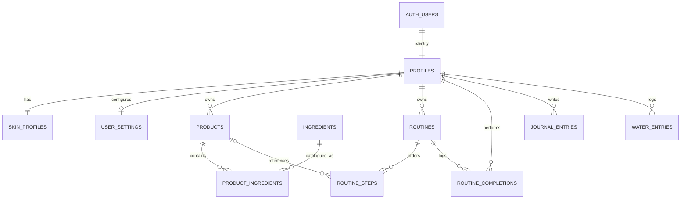

# Little Rituals database schema (Stage 1)

This is the first migration for a **new Supabase project**: [`database/migrations/0001_initial.sql`](../database/migrations/0001_initial.sql). It is the only authoritative initial schema. It is designed for Supabase PostgreSQL and references `auth.users`; it does not connect to or modify any project by itself.

## Relationships

Supabase Auth is the identity source. A database trigger creates `profiles`, `skin_profiles`, and `user_settings` records when an Auth user is created. All user-owned records reference that profile and have row-level policies scoped to `auth.uid()`. Routine step access is checked through its owning routine, and any linked product must also belong to the same user. Ingredient catalog rows are readable by everyone; catalog writes are reserved for trusted server/admin work and have no client write policy.

## Tables and constraints

- `profiles`, `skin_profiles`, `user_settings`: one row per user; personal profile, skin preferences, units, water goal, and optional cycle opt-in state.
- `products`: user-owned library, dates, category, status, price, PAO duration, personal rating, and notes. Expiry and PAO dates remain distinct inputs.
- `ingredients`: curated educational catalog. Empty catalog lookup must be shown as unavailable, not invented.
- `product_ingredients`: normalized product/catalog links, unique per pair.
- `routines`, `routine_steps`, `routine_completions`: routines with ordered steps and one completion summary per routine/date.
- `journal_entries`: private daily record, unique per user/date; ratings and sleep have range checks.
- `water_entries`: individual additions with positive bounded amounts; date grouping uses UTC in this base schema. A later locale-aware date migration should be added before daily streaks are implemented.

UUID keys, foreign keys, date indexes, uniqueness, range checks, update timestamps, and ownership policies are included. There is intentionally no service-role key in browser code. Stage 2 will add the verified Supabase-token middleware and use the caller's JWT for user-scoped operations so RLS remains effective.

## Apply to a fresh Supabase project

1. Create a **new** Supabase project and open its SQL Editor.
2. Review `database/migrations/0001_initial.sql`, then run it once on that new project.
3. In Authentication settings, enable email/password and configure the site's local and production redirect URLs for password recovery.
4. Do not create a public bucket for journal or profile photos. A later stage will define private bucket policies alongside upload routes.
5. Set local values from `.env.example` in an ignored `.env` file. Never paste secrets into chat or commit `.env`.

No Supabase operation has been run in Stage 1.

## Future migrations

Later features will add separate numbered migrations for idempotent XP transactions/quests, badges/garden/bingo/certificates, optional private cycle data, patch tests, goals, travel kits, and export/report support. Apply migrations in order to the new project only. Back up production data and review each migration before applying it; do not edit an already-applied migration as a substitute for a new one.
